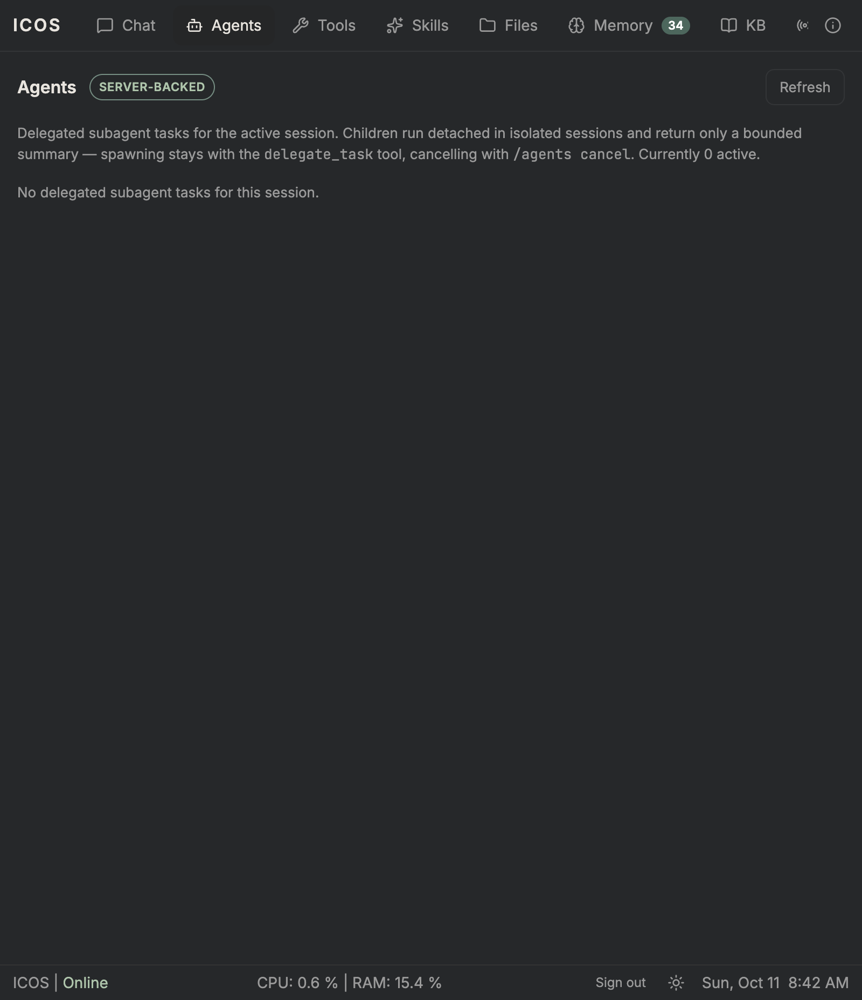

# M21.2 — Subagent integration: evidence

> Status: **verified** (2026-10-11). Slice **M21.2** (capability overlay,
> completion band, approval tagging, `/agents`, Agents tab, read API).
> M21 continues with M21.3 (hardening + evidence).

## Design

- **Capability overlay** (`ToolSurfaceService`, in-memory): `delegate_task`
  accepts `toolsets` / `tools`, intersected with operator policy through the
  M19 alias expansion — narrowing only, never widening. The overlay is set
  synchronously inside `spawn` before the detached run launches (no race
  with the child's first round), applies to universe/disabled/injected/
  discovery, and overlay-excluded tools are declared in the planning frame.
  Held in memory deliberately: it only constrains a running child, and
  restarts fail all children anyway; the request itself stays in the
  transcript as provenance.
- **Completion band**: `unnotifiedTerminal` + `notified_at` cursor (with
  migration) surface newly-terminal delegations once in the parent context
  — bounded (5), entry-capped, fail-soft. Polling stays available but is no
  longer required.
- **Approval tagging** via child-session lookup (no migration, can never
  disagree with the record): chat reply names the task + goal, Discord cards
  carry a 🧵 delegation line, and `GET /core/approvals` items gain an
  optional `delegation` field rendered by the approval card.
- **`/agents [list | status | cancel]`** shares the slash dispatcher, so it
  works on Discord unchanged. **Agents tab** replaces the placeholder with
  the real list (states, goals, bounded summaries). `GET /core/delegations`
  is the read-only API behind it.
- **Cycle fix**: the first wiring (dispatcher → runner → service) closed a
  construction cycle that hung module boot. Resolved with a string-token
  child-turn port (`CHILD_TURN_RUNNER` + `ConversationTurnAdapter` resolving
  lazily, cron precedent) — the only lazy edge; everything else is straight
  DI. Found a second latent bug underneath: `DelegationRepository` was a
  type-only import in `ConversationService`, so decorator metadata recorded
  `Object` and Nest silently injected `undefined` — the M21.1 cancel checks
  and the band would have been dead in production with all unit tests green.
  Audited all DI tokens; that was the only one.

## Unit

Core **1278 unit / 73 e2e**; web **202 tests**; `tsc`/`eslint` + `ng build`
clean (one pre-existing failure: the drift-corpus spec reads a notes file
the working tree moved). New tests: overlay narrowing/addition/no-widening/
clearing/discovery scoping; runner overlay wiring; store context + notified
drain + migration; delegate arg validation; band render-once + degradation;
approval reply tagging (child vs ordinary); controller enrichment + fail-soft;
`/agents` command incl. usage errors; runner `list()`; repeat-skip exemption
for status polls; client delegation model/service/tab/card tests.

## Live

Real model (deepseek-v4.1-flash via opencode), rebuilt containers:

```
POST /core/conversation {"message": "delegate ... restricted to the memory
  toolset only (pass toolsets [\"memory\"]). Reply immediately ..."}
  → 200 ok, reply: "90d07d98-..."   (task_id at once, no blocking)
child transcript:
  [user] [Subagent task — ...] Goal: Check whether I have any beliefs
    about SQLite / Context: Inspect the memory system's beliefs layer ...
  [assistant] ## Summary — Result: No SQLite-related beliefs found ...
    Tools used: 3 successful `memory` queries (budget of 5 steps...) ...

/agents list → 200 "Delegated tasks (1): - 90d07d98 [completed] Check
  whether I have any beliefs about SQLite — ## Summary ..."

neutral parent turn ("Anything new to report?") →
  "Yes — one item. **Subagent finished: `90d07d98…` (memory toolset only)**
   Finding: No SQLite-related beliefs ... Caveat — coverage gap, not a
   clean negative: the child exhausted its 5-step budget ..." (band worked;
   parent relayed the caveat unprompted)

child session asked to run `ls` →
  "I can't do that this turn. The `terminal` tool is explicitly disabled
   in my current configuration ... The only tool I actually have access
   to here is `memory`. ... I won't invent [output] ..." (overlay held;
   refusal + honesty, unprompted)

GET /core/delegations?parentSessionId=… → 200 [{completed, goal, summary…}]
Agents tab → real server-backed list (screenshot below; empty state shown —
  the populated rows are covered by the API output above + client tests)

DELETE child → 200, DELETE parent → 200
```

### Notes

- The narrowed child stayed inside its 5-step budget using only `memory`
  tools — the overlay constrained visibility and the budgets constrained
  cost, independently.
- Approval tagging had no live trigger (research-only subtasks); the paths
  are covered by unit tests (reply, card content, queue enrichment) and the
  e2e approval flow is unchanged — tagged approvals will be exercised live
  in M21.3.
- Browser note: login over plain HTTP requires the `localhost` hostname
  (Secure cookies); `127.0.0.1` silently drops the session. Unrelated to
  this milestone, recorded here so the next probe starts there.


